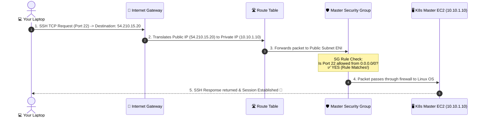
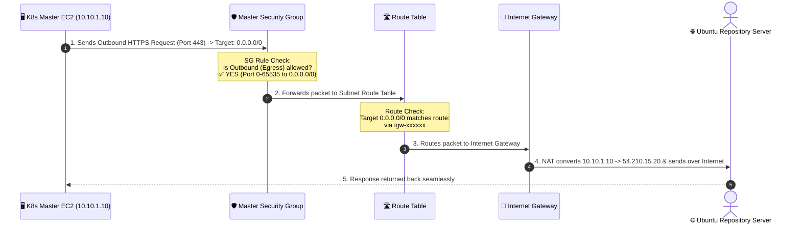
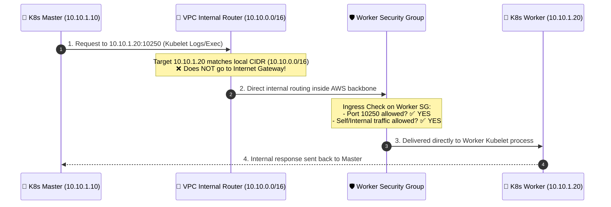

# 🌐 Complete AWS Networking Guide: Architecture, Flow & Scenarios

This document explains **AWS Networking fundamentals**, packet process flows, and real-world scenarios designed specifically for your Kubernetes infrastructure.

---

## 📌 1. Fundamental Networking Components

| Component | AWS Resource | What it does | Real-World Analogy |
| :--- | :--- | :--- | :--- |
| **VPC** | `aws_vpc` | Your isolated virtual private network in AWS (e.g. `10.10.0.0/16` = 65,536 IPs). | Private Gated Land / Property |
| **Subnet** | `aws_subnet` | A subdivided block of IPs inside a VPC (e.g. `10.10.1.0/24` = 256 IPs). | A specific Room inside your house |
| **Internet Gateway** | `aws_internet_gateway` | VPC border component enabling communication between your VPC and the Internet. | The Front Gate of your property |
| **Route Table** | `aws_route_table` | A set of rules (routes) determining where network traffic is directed. | Hallway Directional Signs |
| **Security Group** | `aws_security_group` | Stateful virtual firewall controlling Inbound & Outbound traffic for EC2. | Security Guard at the room door |
| **Public IP** | `map_public_ip_on_launch` | Globally routable IP address accessible over the Internet. | Public Phone Number / Street Address |
| **Private IP** | Auto-assigned | Internal IP accessible ONLY within the VPC (e.g. `10.10.1.15`). | Internal Room Number / Extension |

---

## 🚀 2. Real-World Scenarios & Packet Process Flows

---

### 🟢 Scenario 1: Inbound SSH Connection (Laptop ➔ K8s Master EC2)
**Goal**: You run `ssh ubuntu@54.210.15.20` from your local computer terminal to log into the K8s Master node.

#### Step-by-Step Explanation:
1. **Initiation**: Your laptop sends a TCP packet on port `22` to the public IP `54.210.15.20`.
2. **IGW Translation**: The Internet Gateway receives the packet at the VPC border and translates the Public IP `54.210.15.20` to the internal Private IP `10.10.1.10`.
3. **Subnet Routing**: The Subnet's Route Table recognizes `10.10.1.10` belongs to `k8s-public-subnet`.
4. **Security Group Check**: Before touching the EC2 network interface (ENI), **Security Group (`k8s-master-sg`)** checks its ingress rules:
   - *Rule*: Ingress TCP Port 22 from `0.0.0.0/0` -> **ALLOWED**.
5. **OS Handshake**: The packet hits port 22 of the Linux OS where OpenSSH daemon receives it and completes authentication.

---

### 🔵 Scenario 2: Outbound Internet Access (K8s Master EC2 ➔ Internet)
**Goal**: The Master EC2 node runs `apt-get update` or downloads Kubernetes packages from `https://packages.cloud.google.com`.

#### Step-by-Step Explanation:
1. **Application Request**: Kubelet or APT on the EC2 instance creates a packet targeting external IP `185.125.190.36:80`.
2. **Security Group Egress Check**: Security Group checks egress rules:
   - *Rule*: Egress All Traffic (`-1`) to `0.0.0.0/0` -> **ALLOWED**.
3. **Route Table Lookup**: Subnet Route Table checks destination:
   - `0.0.0.0/0` -> `gateway_id = aws_internet_gateway.k8s_igw.id`.
4. **IGW Network Address Translation (NAT)**: The IGW substitutes the source Private IP (`10.10.1.10`) with the EC2's Public IP (`54.210.15.20`).
5. **Return Traffic**: Because Security Groups are **stateful**, return traffic is automatically allowed back through without needing an explicit inbound rule!

---

### 🟣 Scenario 3: Internal Cluster Communication (Master Node ➔ Worker Node)
**Goal**: K8s Master Node (`10.10.1.10`) connects to K8s Worker Node (`10.10.1.20`) on Kubelet Port `10250` or Flannel CNI overlay UDP `8472`.

#### Step-by-Step Explanation:
1. **Targeting Private IP**: The Master node sends traffic directly to `10.10.1.20` (Worker Private IP).
2. **Local VPC Route**: Every AWS VPC has an automatic default route:
   - `10.10.0.0/16` -> `local`.
   - Traffic **never leaves the AWS network** and **never touches the Internet Gateway**.
3. **Worker Security Group Check**:
   - `worker_sg` checks if port `10250` or internal self-traffic (`protocol = -1`, `self = true`) is allowed -> **ALLOWED**.
4. **Zero Latency High Speed**: Data is transferred over AWS high-speed private fiber infrastructure (up to 10Gbps+).

---

## 🇰🇭 3. សង្ខេបជាភាសាខ្មែរ (Khmer Summary Note)

1. **VPC (`10.10.0.0/16`)**: គឺជា **បណ្តាញផ្ទៃក្នុង (Private Network)** ទាំងមូលនៅក្នុង AWS។
2. **Subnet (`10.10.1.0/24`)**: គឺជា **ផ្នែកមួយនៃ Network** ដែល EC2 របស់អ្នករស់នៅ។
3. **Internet Gateway (IGW)**: គឺជា **ទ្វារចេញចូល Internet**។ បើគ្មាន IGW ទេ EC2 មិនអាចដោនឡូត Docker ឬ K8s ពីក្រៅបានឡើយ។
4. **Route Table**: គឺជា **អ្នកចង្អុលផ្លូវ**។ វាប្រាប់ Subnet ថា បើចង់ចេញទៅពិភពខាងក្រៅ (`0.0.0.0/0`) ត្រូវដើរទៅកាន់ **IGW**។
5. **Security Group**: គឺជា **របាំងការពារ (Firewall)** នៅពីមុខ EC2។ វាពិនិត្យ Port នីមួយៗ (ដូចជា Port 22 SSH, 6443 K8s API, 10250 Kubelet)។ បើគ្មានអនុញ្ញាតក្នុង SG ទេ Packet នឹងត្រូវ Reject ភ្លាមៗ។
